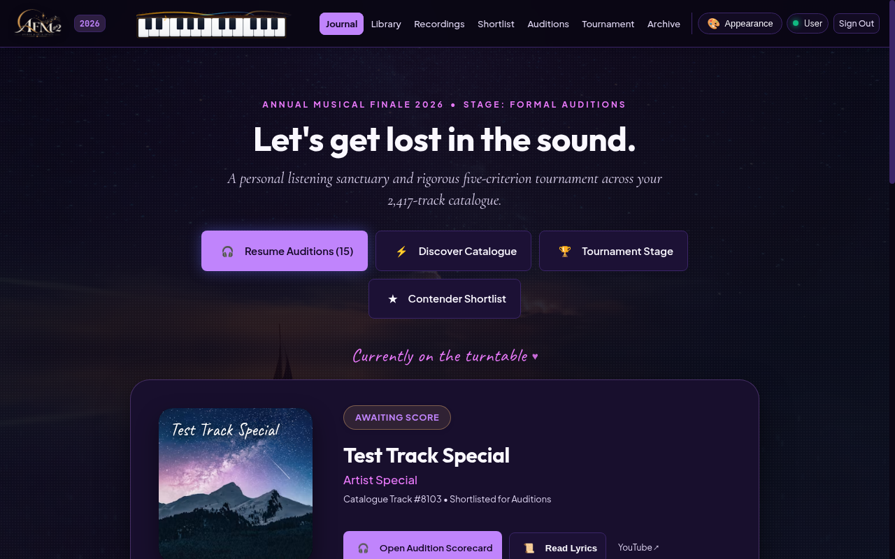
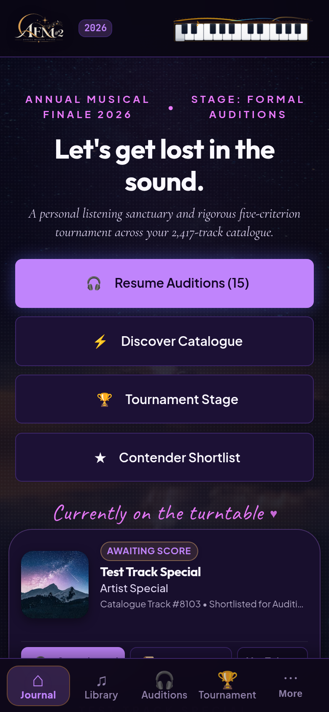
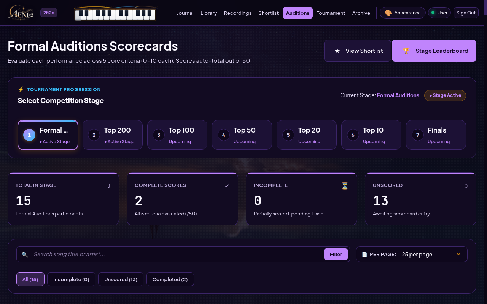
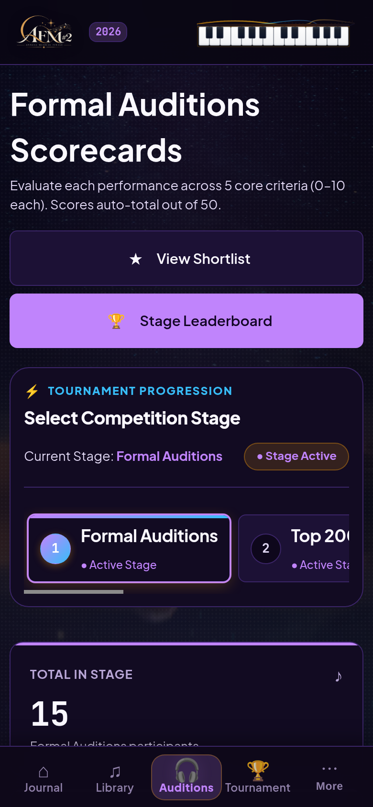
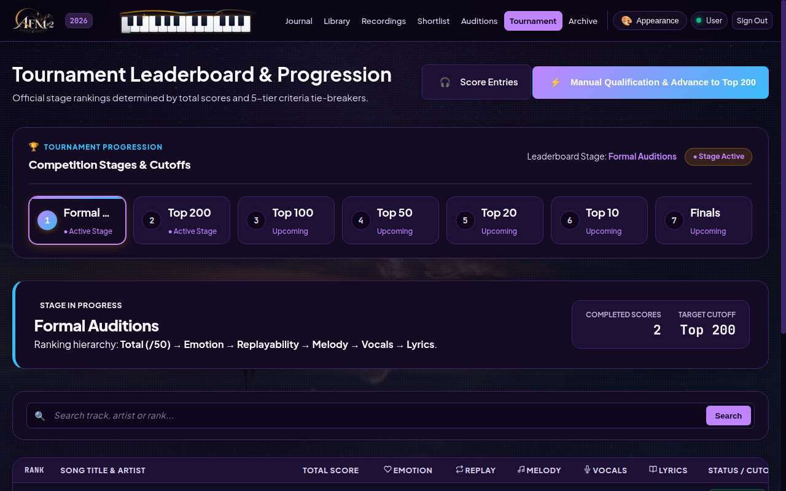
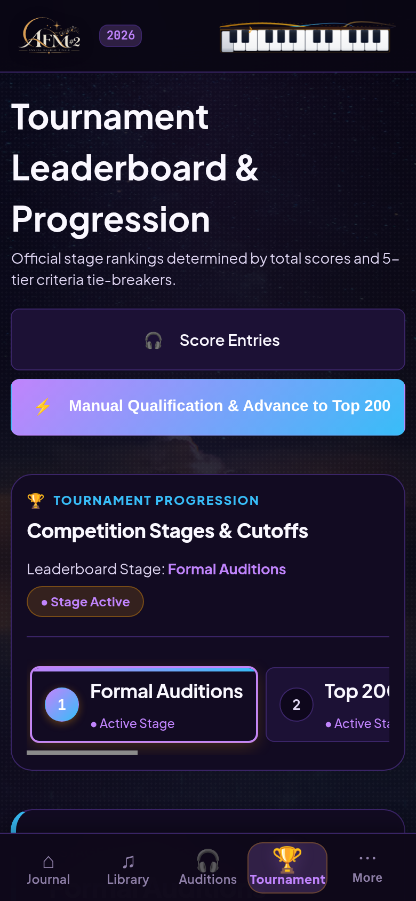

# AFM#2 — Annual Musical Finale 2026

**An Open-Source, Non-Commercial Music Curation Sanctuary & 7-Stage Tournament Web Application**

[](https://github.com/gulshankyy2007/afm2/actions/workflows/security-scan.yml)
[](https://www.php.net/)
[](https://www.mysql.com/)
[](LICENSE)

---

## 1. Project Overview & Philosophy

**AFM#2 (Annual Musical Finale 2026)** is an open-source, non-commercial personal music journal, audition workstation, and tournament platform. Built around the ethos of deliberate, intentional listening, AFM#2 transforms passive music streaming into an active, artistic competition.

Participants explore a curated multi-era music catalogue of **2,411 tracks**, evaluate contenders across five structured artistic dimensions, and steer a seven-stage qualification ladder from initial auditions down to crowning the **2026 Champion Song**.

### Core Philosophy
- **Intentional Curation:** Counteracting infinite algorithmic shuffle by encouraging focused, album-quality listening sessions.
- **Structured Adjudication:** Moving beyond binary "likes" to evaluate songs across Melody, Lyrics, Vocals, Emotion, and Replayability.
- **Artistic Autonomy:** Automated scores provide guidance, while human adjudicators retain full control over stage qualifications and boundary ties.
- **Privacy & Lightweight Engineering:** Zero tracking scripts, zero commercial advertisements, zero frontend framework baggage, and strict multi-user data isolation.

---

## 2. Open-Source & Non-Commercial Status

AFM#2 is developed and maintained strictly as a **non-commercial, open-source personal project**:
- **No Monetization:** The application contains no subscriptions, paid tiers, advertisements, or affiliate programs.
- **No Commercial Data Collection:** User ratings, journal notes, and tournament results remain strictly private and belong exclusively to the user.
- **Educational & Personal Use:** Designed for music enthusiasts, private listening groups, and tournament adjudicators.

---

## 3. Technology Stack & Architecture

AFM#2 is engineered with lightweight, native web standards to maximize performance, durability, and portability across zero-cost shared hosting (e.g. InfinityFree, cPanel) and modern cloud containers (Docker, Render, Railway, VPS):

| Layer | Technologies & Implementations |
|---|---|
| **Backend** | Native **PHP 8.2+** with strict typing (`declare(strict_types=1)`), PDO prepared statements, argon2id/bcrypt password hashing, and RFC 6797 HTTPS transport verification. |
| **Database** | **MySQL 8.0+ / MariaDB 10.4+ / 11.4** with `utf8mb4_unicode_ci` collation, stored generated columns, and foreign-key integrity constraints. |
| **Frontend** | Semantic **HTML5**, Vanilla **CSS3** (custom properties design system, 8 cohesive themes, fluid clamp typography, mobile navigation drawer), and Vanilla **ES6+ JavaScript** (zero npm runtime dependencies). |
| **Authentication** | Modular multi-method architecture: Native Credentials, Google OAuth 2.0 / OpenID Connect, and **WebAuthn / FIDO2 Passkeys**. |
| **Media & Lyrics** | Privacy-enhanced YouTube player (`youtube-nocookie.com`), **LRCLIB** synchronized lyrics API with local database caching, and Lyrics.ovh automated fallback. |
| **Security** | Defense-in-depth HTTP headers (CSP, HSTS, X-Frame-Options, Permissions-Policy), timing-safe CSRF tokens, strict IDOR prevention, IP/composite rate limiting, and formula-injection-safe CSV export. |

---

## 4. Key Features & Capabilities

### Atmospheric Design & 8 Cohesive Themes
AFM#2 features a custom-built design system with WCAG 2.1 AA compliant color contrast, 44px+ touch targets, real-time background blur adjustments, and eight responsive themes:
1. **Midnight Ember** *(Default Dark)*: Warm amber coals, charcoal dusk, and obsidian depth.
2. **Nordic Frost** *(Hero Light)*: Crisp architectural monolith, snow-white canvas, and royal sapphire blue.
3. **Velvet Amethyst**: Cosmic twilight, deep indigo, and luminous neon lavender.
4. **Emerald Forest**: Verdant alpine spruce, shadowy forest floor, and vibrant mint.
5. **Vintage Parchment** *(Light)*: Aged archival paper, warm sepia, and deep walnut ink.
6. **Solar Terracotta** *(Light)*: Sun-drenched Tuscan clay, terracotta warmth, and desert sienna.
7. **Oceanic Dusk**: Deep midnight marine horizon and bioluminescent cyan.
8. **Quiet Minimal**: Serene architectural studio, warm white canvas, and soft charcoal.

### Catalogue & Library Management
- **2,411 Starter Catalogue Tracks:** Pre-seeded catalogue spanning multiple decades and genres, cloned independently for each registered user.
- **Instant Search & Multi-Field Sorting:** Filter by Title, Artist, Track ID, or Evaluation Status with zero server lag.
- **Bulk Action Safeguards:** Protected multi-track operations that prevent accidental deletion of shortlisted, scored, or tournament-active entries.

### Discovery Shortlist
- **One-Tap Candidate Intake:** Streamlined triage with one-tap Shortlist, Pass, or Reset actions.
- **Responsive Presentation:** Compact numeric badges on desktop; spacious, touch-friendly cards on mobile devices.

### Recordings & Audio Experience
- **Multi-Source YouTube Matching:** Automated search query heuristics with thumbnail previews and duration verification.
- **Interactive Synced Lyrics:** Real-time line-by-line active lyric tracking with click-to-seek playback timestamps.
- **Personal Lyric Overrides:** Secure user overrides for missing tracks, cached privately per-user.

---

## 5. Tournament Structure & Progression

The competition advances through a rigorous 7-stage tournament ladder:

```
[ 2,411 Starter Catalogue ]
            │
            ▼
┌────────────────────────────────────────┐
│ Stage 1: Formal Auditions              │ ◄── All shortlisted candidates scored (/50)
└──────────────────┬─────────────────────┘
                   │ Top 200 Qualifiers
                   ▼
┌────────────────────────────────────────┐
│ Stage 2: Top 200                       │
└──────────────────┬─────────────────────┘
                   │ Top 100 Qualifiers
                   ▼
┌────────────────────────────────────────┐
│ Stage 3: Top 100                       │
└──────────────────┬─────────────────────┘
                   │ Top 50 Qualifiers
                   ▼
┌────────────────────────────────────────┐
│ Stage 4: Top 50                        │
└──────────────────┬─────────────────────┘
                   │ Top 20 Semi-Finalists
                   ▼
┌────────────────────────────────────────┐
│ Stage 5: Top 20                        │
└──────────────────┬─────────────────────┘
                   │ Top 10 Finalists
                   ▼
┌────────────────────────────────────────┐
│ Stage 6: Top 10 (Championship Finals)  │
└──────────────────┬─────────────────────┘
                   │ Final Adjudication
                   ▼
┌────────────────────────────────────────┐
│ Stage 7: The Grand Finale              │ ◄── 2026 Champion Song Crowned 🏆
└────────────────────────────────────────┘
```

---

## 6. Audition & Evaluation Criteria

Every track is scored across five distinct artistic criteria, each calibrated on a `0.0` to `10.0` scale:

| Criterion | Dimension Evaluated | Weight |
|---|---|:---:|
| **Melody (♫)** | Harmonic richness, melodic memorability, composition progression | 10 pts |
| **Lyrics (📝)** | Narrative depth, poetic resonance, storytelling, linguistic craft | 10 pts |
| **Vocals (🎤)** | Vocal expression, timbre, technical delivery, range, emotional presence | 10 pts |
| **Emotion (❤️)** | Visceral impact, atmosphere, goosebumps, lasting emotional resonance | 10 pts |
| **Replayability (🔁)** | Longevity across repeated listens, timelessness, enduring appeal | 10 pts |
| **TOTAL** | **Aggregate Audition Score** | **/ 50 pts** |

The aggregate total is computed automatically via a MySQL stored generated column:
$$\text{Total} = \text{Melody} + \text{Lyrics} + \text{Vocals} + \text{Emotion} + \text{Replayability}$$

### Deterministic 5-Tier Tie-Breaking
When candidates tie on aggregate total at a stage qualification boundary, AFM#2 resolves position through a deterministic hierarchy:
$$\text{Emotion} \rightarrow \text{Replayability} \rightarrow \text{Melody} \rightarrow \text{Vocals} \rightarrow \text{Lyrics} \rightarrow \text{Adjudicator Choice}$$

---

## 7. Directory Structure

```text
/
├── .github/
│   ├── dependabot.yml            # Dependabot configuration for GitHub Actions
│   └── workflows/
│       └── security-scan.yml     # Automated Gitleaks & PHP syntax verification
├── .env.example                  # Sanitized environment configuration template
├── .gitignore                    # Comprehensive security and build exclusion policy
├── .gitleaks.toml                # Gitleaks secret detection rules and allowlist
├── index.php                     # Root entry point bridging to public/index.php
├── robots.txt                    # Search crawler rules (allows noindex reading)
├── sitemap.xml                   # Public sitemap (strictly public informational pages)
├── bin/                          # Management utilities & automation scripts
│   ├── admin_recovery.php        # CLI administrator account recovery tool
│   ├── build-infinityfree-release.sh # Production asset minification & packaging
│   ├── bulk_youtube_matcher.php  # Automated YouTube candidate matcher
│   └── hooks/
│       └── pre-commit            # Local pre-commit secret detection script
├── config/                       # Application configuration
│   ├── config.php                # Environment loader, security headers, HTTPS detection
│   └── db.php                    # PDO connection provider (UTF-8mb4, prepared statements)
├── docs/                         # Authoritative documentation and user manuals
│   ├── AFM2_Participants_Guide_2026.md   # Official participant handbook source
│   ├── AFM2_Participants_Guide_2026.html # Formatted participant handbook
│   ├── participant_guide.css     # Handbook styling
│   └── screenshots/              # High-resolution desktop and mobile UI previews
├── includes/                     # Application logic, helpers, and services
│   ├── artwork_helper.php        # Album art extraction and CDN fallbacks
│   ├── auth.php                  # Modular authentication and session security
│   ├── csrf.php                  # Timing-safe CSRF token lifecycle
│   ├── db_helper.php             # Core database queries, tournament logic
│   ├── duplicate_helper.php      # Duplicate track candidate detection
│   ├── footer.php                # Layout footer, audio player, modal scripts
│   ├── google_auth_service.php   # Google OAuth 2.0 / OpenID Connect provider
│   ├── header.php                # Layout header, navigation drawer, theme selector
│   ├── import_helper.php         # CSV import parser and formula injection guard
│   ├── media_helper.php          # LRCLIB & Lyrics.ovh multi-source lyrics fetcher
│   ├── preferences_helper.php    # User theme and UI layout persistence
│   ├── webauthn_service.php      # FIDO2 / WebAuthn passkey registration & verification
│   └── youtube_matcher.php       # YouTube search and metadata extraction engine
├── migrations/                   # Additive, version-controlled database migrations
│   ├── 001_init_app_tables.php through 015_align_tournament_collations.php
│   └── migration_runner.php      # Migration execution engine (CLI & web)
├── public/                       # Web server document root
│   ├── .htaccess                 # Apache security rules and security headers
│   ├── about.php                 # About AFM#2 philosophy and curation rules
│   ├── account.php               # Account profile, credentials, passkey management
│   ├── admin_migrate.php         # Hardened database migration & reconciliation console
│   ├── api.php                   # Secure CSRF-protected JSON REST endpoint
│   ├── auditions.php             # Multi-criteria scoring interface
│   ├── contact.php               # Maintainer contact & open-source disclosures
│   ├── discovery.php             # Shortlist evaluation view
│   ├── index.php                 # Journal dashboard & tournament status
│   ├── invite.php                # Single-use tokenized invitation onboarding
│   ├── landing.php               # Public introduction for unauthenticated visitors
│   ├── library.php               # Catalogue browser, multi-field search, modal CRUD
│   ├── login.php                 # Multi-method login screen (branded & crawler-protected)
│   ├── logout.php                # POST-only CSRF-protected session termination
│   ├── privacy.php               # Factual privacy and data protection policy
│   ├── recordings.php            # YouTube matching and recording workbench
│   ├── results.php               # Historical tournament archive & CSV export
│   ├── setup.php                 # One-time administrator setup (fails closed)
│   ├── terms.php                 # Terms of Use guidelines
│   ├── tournament.php            # Stage leaderboards & manual qualification console
│   ├── users.php                 # Administrator user management & invitation console
│   └── assets/                   # Pre-compiled, cache-busted CSS, JS, and image assets
├── tests/                        # Automated regression, isolation, and security test suites
│   ├── test_batch_a_auth_integrity.php
│   ├── test_batch_b_cookie_security.php
│   ├── test_batch_c_csv_security.php
│   ├── test_batch_d_request_hardening.php
│   ├── test_batch_e_rate_limiting_and_headers.php
│   ├── test_modular_auth.php     # Multi-method auth suite (38 assertions)
│   ├── test_multiuser_isolation.php # Two-user isolation suite (58 assertions)
│   ├── test_phase2_security_remediation.php # Phase 2 verification suite (33 assertions)
│   └── test_suite.php            # Core catalogue and tournament logic suite
└── deployment/                   # Deployment guides, Dockerfile, and setup scripts
```

---

## 8. Authentication & Security Architecture

AFM#2 enforces comprehensive defensive controls across every layer:

```
                  ┌────────────────────────────────────────┐
                  │          Incoming Web Request          │
                  └───────────────────┬────────────────────┘
                                      │
                       [ HTTPS Transport Verification ]
                                      │
                   [ Defense-in-Depth Security Headers ]
             (CSP, HSTS, X-Content-Type-Options, X-Frame-Options)
                                      │
               [ Search Crawler Control: X-Robots-Tag ]
         (Auth & internal endpoints instructed: noindex, nofollow)
                                      │
                   [ Rate Limiting & Abuse Prevention ]
             (IP-based & composite account-specific buckets)
                                      │
                                      ▼
               ┌──────────────────────────────────────────────┐
               │         Modular Authentication Gate         │
               ├──────────────┬────────────────┬──────────────┤
               │   Password   │  Google OIDC   │   WebAuthn   │
               │ (argon2id)   │ (RS256 JWT)    │   (FIDO2)    │
               └──────────────┴────────────────┴──────────────┘
                                      │
                                      ▼
                  ┌────────────────────────────────────────┐
                  │    Authenticated User Session Context  │
                  ├────────────────────────────────────────┤
                  │  • Timing-Safe CSRF Token Validation   │
                  │  • Multi-User Isolated Starter Data    │
                  │  • Mutative IDOR Safety Boundaries     │
                  │  • Formula-Injection-Safe CSV Export   │
                  └────────────────────────────────────────┘
```

### Authentication Methods
1. **Native Username/Email & Password:** Secure password storage using PHP `PASSWORD_DEFAULT` (argon2id or bcrypt with cost factor 12).
2. **Google OAuth 2.0 / OpenID Connect:** Cryptographically verified identity with RS256 token validation against Google's public JWKS. Complies with Google Identity Branding Guidelines (*"Continue to AFM#2 with Google"*).
3. **WebAuthn / FIDO2 Passkeys:** Hardware-backed biometric and security key authentication with anti-replay signature counters.
4. **Administrator Provisioning:** Invitation-only registration via cryptographically random 64-hexadecimal tokens.

### Preventive Security Controls
- **Search Engine Isolation:** All authentication, setup, admin, and API endpoints emit `X-Robots-Tag: noindex, nofollow, noarchive` headers. Protected route redirects emit `noindex` to prevent crawler evaluation.
- **Admin Secret Hardening:** Administrative endpoints (`admin_migrate.php`) reject query parameter secrets (`GET ?secret=`), accepting authorization strictly via `$_POST['secret']` or `X-App-Secret` headers with zero parameter leakage in 403 responses.
- **CSRF Defense:** Cryptographically secure 256-bit hexadecimal CSRF tokens tied to user sessions and validated with `hash_equals()`.
- **IDOR Protections:** Every mutation query scopes operations strictly by `WHERE user_id = :uid`. Cross-user editing or deletion is rejected.
- **Formula Injection Safeguard:** All CSV exports prepend a single quotation mark (`'`) to cells starting with `=`, `+`, `-`, `@`, `\t`, or `\r`.

---

## 9. Local Installation & Configuration

### Prerequisites
- PHP 8.2 or later with extensions: `pdo_mysql`, `curl`, `json`, `mbstring`, `openssl`, `session`.
- MySQL 8.0+ or MariaDB 10.4+.
- Web server: Apache (with `mod_rewrite` and `mod_headers`) or Nginx.

### Step-by-Step Setup

1. **Clone the Repository:**
   ```bash
   git clone https://github.com/gulshankyy2007/afm2.git
   cd afm2
   ```

2. **Configure Environment Variables:**
   ```bash
   cp .env.example .env
   ```
   Open `.env` and configure your database settings and application secret:
   ```ini
   APP_ENV=development
   APP_SECRET=your_random_64_character_hex_secret_here
   DB_HOST=127.0.0.1
   DB_PORT=3306
   DB_NAME=afm_db
   DB_USER=your_local_db_user
   DB_PASS=your_local_db_password
   ```
   *(Generate a secure secret via terminal: `php -r 'echo bin2hex(random_bytes(32)) . PHP_EOL;'`)*

3. **Initialize the Database:**
   Create the database in MySQL:
   ```sql
   CREATE DATABASE afm_db CHARACTER SET utf8mb4 COLLATE utf8mb4_unicode_ci;
   ```
   Run the automated database migration runner:
   ```bash
   php migrations/migration_runner.php
   ```

4. **Start the Local Development Server:**
   ```bash
   php -S 127.0.0.1:8000 -t public
   ```
   Open `http://127.0.0.1:8000/setup.php` in your browser to create the initial administrator account. Once provisioned, `setup.php` permanently locks.

---

## 10. Preventive Secret Scanning & Developer Workflow

AFM#2 enforces automated secret detection to ensure credentials, private keys, and environment files are never published:

### 1. Gitleaks Configuration (`.gitleaks.toml`)
The repository includes `.gitleaks.toml` which extends the standard Gitleaks rule library while allowlisting sanitized documentation templates (`.env.example`) and test fixtures.

### 2. Local Pre-Commit Hook
Developers can enable automatic pre-commit scanning by installing the provided hook:
```bash
cp bin/hooks/pre-commit .git/hooks/pre-commit
chmod +x .git/hooks/pre-commit
```
*(Or globally configure Git: `git config core.hooksPath bin/hooks`)*

### 3. Continuous Integration (GitHub Actions)
Every `push` and `pull_request` to `main` and `impl/responsive-redesign` triggers `.github/workflows/security-scan.yml`, running:
- **Gitleaks Scan:** Deep historical and staged commit analysis with `--redact` enabled.
- **PHP Syntax & Config Lint:** Syntax checking across all files and validation of `.env.example`.

---

## 11. Screenshots & Interface Previews

| Desktop Workbench | Mobile Adaptive Layout |
|:---:|:---:|
|  |  |
| *Auditions Workbench (Desktop)* | *Auditions Card View (Mobile)* |
|  |  |
| *Tournament Leaderboard (Desktop)* | *Tournament Bracket (Mobile)* |
|  |  |

---

## 12. Deployment Considerations

### InfinityFree / Shared Hosting
1. Generate the production bundle:
   ```bash
   bash bin/build-infinityfree-release.sh
   ```
   This compiles and minifies CSS/JS with `esbuild`, validates syntax, and produces `deployment/afm2-infinityfree-release.zip`.
2. Upload the contents of the ZIP into the `htdocs/` directory via File Manager or FTP.
3. Create the database via cPanel / VistaPanel and run migrations using `public/admin_migrate.php` (authenticating via administrator session or POST secret token).
4. **Hosting Proxy Notice:** Free hosting providers (e.g. ByetHost / InfinityFree) inject transient client-side challenge scripts (`/aes.js`). For optimal crawler performance and custom domain branding, connecting a custom domain with Cloudflare's free proxy is recommended.

### Cloud Containers (Docker / VPS / Render)
The `deployment/` directory includes a multi-stage `Dockerfile`, `docker-compose.yml`, and `vps-setup.sh` for one-command container deployment on modern Linux servers.

---

## 13. Known Limitations & Roadmap

- **Audio Playback:** Relies on the YouTube IFrame API; tracks not available on YouTube require manual link association.
- **Hosting Anti-Bot Friction:** Free hosting challenge scripts can occasionally delay first-time automated indexing by search bots.
- **Future Enhancements:**
  - Native offline-first PWA caching for mobile auditioning.
  - Multi-judge aggregate consensus scoring mode.
  - Spotify / Apple Music playlist export integration.

---

## 14. Contribution Guidelines

Contributions are welcome from music enthusiasts and open-source developers!
1. Fork the repository on GitHub.
2. Create a focused feature branch: `git checkout -b feature/my-enhancement`.
3. Ensure all tests pass: `php tests/test_modular_auth.php && php tests/test_multiuser_isolation.php`.
4. Ensure no secrets are staged: `gitleaks protect --staged`.
5. Submit a pull request with a detailed description of changes.

---

## 15. Licence Information

AFM#2 is released as open-source software under the terms of the **[MIT License](LICENSE)**:

```text
MIT License
Copyright (c) 2026 Gulshan Yadav
```

Permission is hereby granted, free of charge, to any person obtaining a copy of this software and associated documentation files (the "Software"), to deal in the Software without restriction, including without limitation the rights to use, copy, modify, merge, publish, distribute, sublicense, and/or sell copies of the Software, and to permit persons to whom the Software is furnished to do so, subject to the conditions stated in the [LICENSE](LICENSE) file.

---

## 16. Contact & Maintainer Information

- **Project Maintainer:** Gulshan Yadav ([@gulshankyy2007](https://github.com/gulshankyy2007))
- **Official Repository:** [https://github.com/gulshankyy2007/afm2](https://github.com/gulshankyy2007/afm2)
- **Live Application:** [https://afm2.infinityfreeapp.com/](https://afm2.infinityfreeapp.com/)
- **Participant Handbook Web Manual:** [https://afm2-user-manual.netlify.app/](https://afm2-user-manual.netlify.app/)
