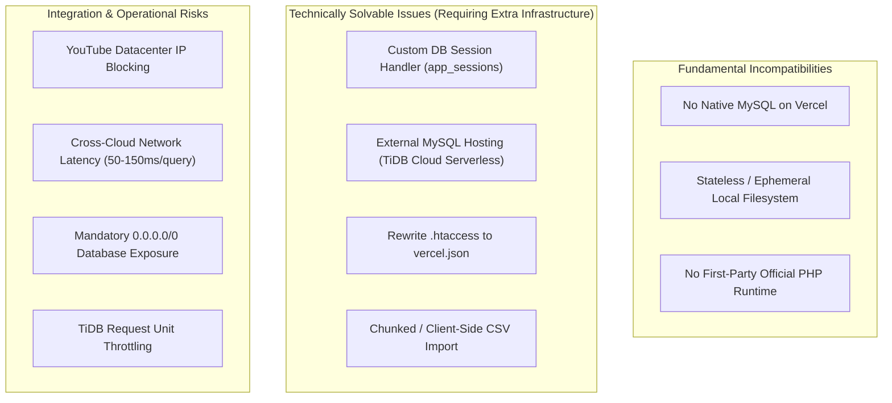

# AFM#2 — Hosting Decision Record (HDR-001)

**Project:** AFM#2 (Personal Music Journal & Tournament)  
**Status:** **DECIDED & RECORDED**  
**Date:** November 2026  
**Context:** Post-Vercel Deployment Compatibility Audit & Hosting Alternatives Analysis  
**Related Documents:**
- [`vercel_deployment_compatibility_audit.md`](file:///home/gulshan-yadav/.gemini/antigravity-ide/brain/070b97cb-54b1-47d6-90ac-c6e27a2cefb2/vercel_deployment_compatibility_audit.md)
- [`ZERO_COST_HOSTING_EVALUATION.md`](file:///mnt/data/GY/Music/AFM%232/deployment/ZERO_COST_HOSTING_EVALUATION.md)
- [`HOSTING_MIGRATION_READINESS.md`](file:///mnt/data/GY/Music/AFM%232/deployment/HOSTING_MIGRATION_READINESS.md)

---

## 1. Executive Decisions

### Decision 1: Vercel Hobby is REJECTED as an AFM#2 Hosting Target
Vercel's free Hobby plan is formally rejected and will not be pursued further for AFM#2.

### Decision 2: InfinityFree is Retained as the Temporary Production Baseline
InfinityFree remains the active production host for AFM#2 on an interim basis while the project operates under strict zero-cost and no-card constraints. This is an operational baseline, not an endorsement of InfinityFree's long-term infrastructure reliability.

---

## 2. Decision Record 1: Formal Closure of Vercel Evaluation

### 2.1 Decision Summary
Following the exhaustive technical audit documented in [`vercel_deployment_compatibility_audit.md`](file:///home/gulshan-yadav/.gemini/antigravity-ide/brain/070b97cb-54b1-47d6-90ac-c6e27a2cefb2/vercel_deployment_compatibility_audit.md), Vercel Hobby is classified as **NOT RECOMMENDED** and formally rejected. AFM#2 will not be deployed on Vercel unless the application architecture or project constraints undergo a fundamental redesign.

### 2.2 Decisive Audit Findings
The rejection is based on eight primary architectural and operational realities:

1. **Absence of Official PHP Runtime:** Vercel does not provide a first-party PHP serverless runtime. While official runtimes exist for Node.js, Bun, Python, Go, Ruby, and Rust, deploying PHP on Vercel requires third-party community adapters (`vercel-community/php`) or beta microVM containers (FrankenPHP). Neither provides an enterprise SLA or long-term stability guarantee from Vercel.
2. **Absence of Native MySQL Database:** Vercel provides no native MySQL hosting. Its relational database offering (Vercel Postgres via Neon) exclusively supports PostgreSQL. Deploying AFM#2 on Vercel necessitates connecting across the public internet to an external, third-party MySQL provider.
3. **Session & Security State Breakdown:** AFM#2's authentication, administrator authorization, Google OAuth callback verification, WebAuthn passkey registration/assertion, and CSRF token validations depend on native PHP sessions (`session_start()`, `$_SESSION`) and session files written to `/tmp`. Because Vercel Functions execute across distributed, ephemeral, stateless microVM containers, local filesystem state does not persist between requests. Without a custom database-backed session handler, user logins drop randomly and CSRF checks fail with HTTP 403 Forbidden.
4. **Multi-Step CSV Import Wizard Failure:** AFM#2's catalogue onboarding wizard stages uploaded CSV files on disk (`sys_get_temp_dir() . '/afm2_import_...'`) and caches the multi-thousand-row parsed structure in `$_SESSION` across a three-step review wizard. In Vercel's serverless environment, subsequent wizard steps execute on different microVM instances where neither the staged file nor the session data exists.
5. **Cross-Cloud Latency & Failure Dependencies:** On monolithic hosting (InfinityFree or a VPS), PHP communicates with MySQL over `127.0.0.1` or UNIX domain sockets with sub-millisecond latency (`<0.5 ms`). On Vercel, every database query must cross the public internet to an external provider (such as TiDB Cloud), adding 50 ms to 150 ms of network round-trip latency per query. For pages executing 8 to 15 queries (e.g. Music Library, Audition scorecards, and Tournament progression), page load time degrades by 0.8 to 2.2 seconds purely in network transit.
6. **Loss of Native Apache `.htaccess` Routing:** Vercel completely ignores Apache `.htaccess` configuration. All URL rewrites, static asset exclusions, MIME types, security headers (CSP, HSTS, X-Frame-Options), and cache policies would have to be manually translated and maintained in `vercel.json`.
7. **Outbound YouTube Discovery Restrictions:** AFM#2's zero-cost YouTube recording discovery engine relies on direct HTTP scraping of `ytInitialData`. Outbound requests originating from AWS Lambda / Vercel public datacenter IP ranges are heavily flagged, challenged with CAPTCHAs, or blocked by YouTube bot filters.
8. **Disproportionate Architectural Complexity:** Attempting to run a server-rendered PHP monolith with relational state on a serverless microVM platform represents a severe architectural mismatch (the "serverless monolith anti-pattern"), yielding high latency and operational fragility without any serverless scalability benefits.

### 2.3 Categorization of Technical Constraints

To maintain technical objectivity, the audit findings are categorized into three distinct classes:

- **Fundamental Incompatibilities:** Vercel's platform architecture provides no persistent local disk, no native MySQL, and no official PHP runtime. AFM#2 cannot run unmodified on Vercel.
- **Technically Solvable Issues:** Sessions can be re-engineered to a database table; `.htaccess` can be translated to `vercel.json`; CSV import can be rewritten for chunked client-side streaming. However, implementing these changes violates the project mandate to *preserve the existing PHP/MySQL architecture without redesigning merely to accommodate hosting*.
- **Integration Risks:** Exposing external database port 4000 to `0.0.0.0/0` (because Vercel Hobby lacks static egress IPs), cumulative query latency over WAN, and AWS Lambda IP blocking on YouTube represent severe operational risks.

---

## 3. Decision Record 2: InfinityFree as Temporary Baseline

### 3.1 Decision Summary
AFM#2 will temporarily remain on **InfinityFree** as its active production host.

### 3.2 Justification for Retaining InfinityFree
1. **Architectural Compatibility:** InfinityFree natively supports AFM#2's authentic stack: Apache 2.4, PHP 8.2, MariaDB 10.4+, native file-based sessions, and `.htaccess` rewrite rules.
2. **Zero Incurred Migration Risk:** Application code, multi-user isolation, tournament brackets, and 2,411+ catalogue records are already operational on the platform. Migrating without a verified superior destination risks downtime and data corruption.
3. **Co-Located Database Performance:** PHP and MariaDB reside within the same data center cluster, executing queries over local network sockets with `<0.5 ms` latency.
4. **Recent Performance & Concurrency Hardening:** Extensive optimizations developed across branches `sec/phase-3b-security-hardening` and `perf/multiuser-concurrency` directly target and mitigate InfinityFree's historical resource constraints.

### 3.3 Inspection of Codebase & Optimization History
Inspection of the actual Git repository confirms the current status of performance and architectural branches:

- **Production Baseline Reference:** Branch `main` (Commits `4cf81b1` "Restore authentic InfinityFree production baseline on main" through `17785ad` "Remove external background play button from player footer").
- **Latest Implementation Branch:** `perf/multiuser-concurrency` (HEAD: `97fe317` "feat(a11y): modal dialogs, forms, touch targets, and accessibility refinements").
- **Key Local Optimizations Ready for Deployment:**
  - `ce1ea8c`: Automated Gzip compression (`mod_deflate`), 1-year browser caching for versioned assets (`mod_expires`), and elimination of redundant dashboard footer queries.
  - `e2ec546`: Streamlined catalogue table row HTML, pruning redundant attributes and reducing payload size.
  - `2484a5f`: Automated asset minification pipeline using `esbuild` via [`bin/build-infinityfree-release.sh`](file:///mnt/data/GY/Music/AFM%232/bin/build-infinityfree-release.sh) and simplified sorting expressions.
  - `3cda71c`, `770a29c`, `b58e346`, `97fe317`: Dedicated mobile responsive architecture ([`public/assets/css/mobile.css`](file:///mnt/data/GY/Music/AFM%232/public/assets/css/mobile.css)), accessible touch targets, and modal keyboard trapping.

> [!IMPORTANT]
> **Deployment Status Distinction:**  
> These optimizations are fully implemented, verified, and packaged inside [`deployment/afm2-infinityfree-release.zip`](file:///mnt/data/GY/Music/AFM%232/deployment/afm2-infinityfree-release.zip), but they represent *local repository assets*. They must not be assumed to be already active on the live InfinityFree production instance until an authorized maintenance deployment is performed.

### 3.4 Inherent Limitations of Free Shared Hosting
Application-level performance optimizations reduce CPU execution time, memory usage, and daily hit counts. However, they **cannot** resolve the structural risks of InfinityFree:
- **Provider Infrastructure Outages:** Server hardware failures, storage cluster crashes, or maintenance windows at iFastNet/InfinityFree remain outside application control.
- **Provider DNS & Network Drops:** DNS resolution failures and network routing issues are provider-level events.
- **Account Suspensions:** Automated monitoring systems may suspend accounts if daily CPU, Entry Process (EP), or I/O limits are breached during unexpected traffic spikes.
- **Security & Feature Restrictions:** Blocked outbound port 25, disabled remote MySQL connections, and absence of cron jobs remain permanent free-tier constraints.

---

## 4. Current Project Constraints

All hosting decisions for AFM#2 are governed by the following rigid constraints:

| Constraint | Requirement | Rationale |
| :--- | :--- | :--- |
| **Budget** | **Strict ₹0/month ($0.00)** | AFM#2 is a personal journal and tournament system with zero commercial revenue. |
| **Payment Verification** | **Zero credit/debit card entry** | No financial instruments may be submitted, eliminating trial traps and surprise billing. |
| **Management Level** | **Managed hosting preferred** | Infrastructure maintenance, OS security patches, and server daemons should be managed. |
| **Server Administration**| **No mandatory Linux sysadmin** | Developer time must focus on application features, not OS upgrades and firewall tuning. |
| **Architecture** | **Preserve PHP/MySQL monolith** | Zero code rewrites merely to appease hosting constraints; preserve vanilla simplicity. |
| **Data Integrity** | **100% preservation of data** | All 2,411+ songs, scorecards, audit histories, and user records must remain intact. |
| **Functionality** | **Zero feature sacrifice** | Multi-auth, WebAuthn, YouTube discovery, LRCLIB lyrics, and CSV import must work. |

---

## 5. Conditions for Revisiting Hosting Decisions

The decisions recorded in HDR-001 will remain in effect until one or more of the following boundary conditions change:

1. **Budget Allocation:** If a dedicated infrastructure budget of **₹300 – ₹500/month ($3.50 – $6/mo)** is allocated, the project will immediately evaluate dedicated low-cost persistent hosting (e.g. Hetzner Cloud VPS, DigitalOcean Droplet, or managed PHP on Render/Railway).
2. **Architectural Redesign:** If AFM#2 is ever re-architected from a server-rendered PHP application into a decoupled Single Page Application (SPA) frontend with a stateless Node.js / Go REST API, Vercel or similar serverless platforms may be reassessed.
3. **Emergence of a Verified Zero-Cost Managed Host:** If a managed host emerges that satisfies all 13 mandatory criteria—including PHP 8.2+, local MySQL, persistent sessions, zero credit card requirements, and provable uptime superior to InfinityFree—a controlled migration evaluation will be initiated under [`HOSTING_MIGRATION_READINESS.md`](file:///mnt/data/GY/Music/AFM%232/deployment/HOSTING_MIGRATION_READINESS.md).
