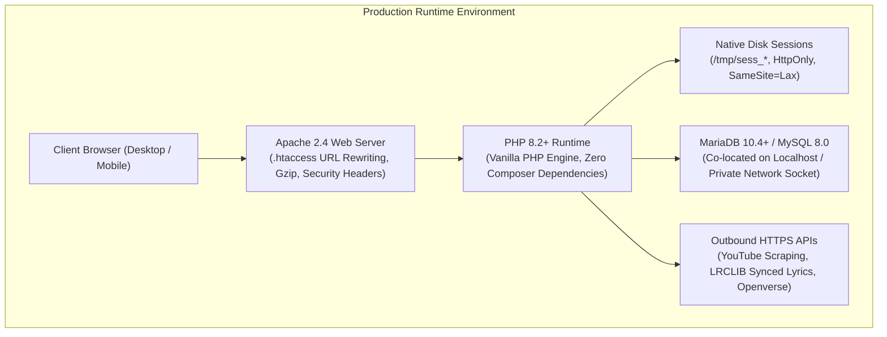
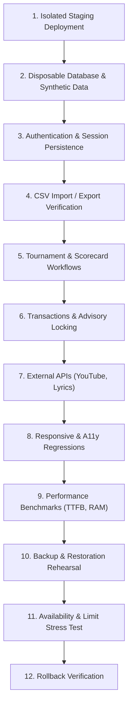

# AFM#2 — Hosting Migration Readiness & Safe Execution Guide

**Project:** AFM#2 (Personal Music Journal & Tournament)  
**Document Purpose:** Pre-flight Requirements, Staging Validation Protocol & Production Gate  
**Date:** November 2026  
**Status:** **ACTIVE PROTOCOL**  
**Related Documents:**
- [`HOSTING_DECISION_RECORD.md`](file:///mnt/data/GY/Music/AFM%232/deployment/HOSTING_DECISION_RECORD.md)
- [`ZERO_COST_HOSTING_EVALUATION.md`](file:///mnt/data/GY/Music/AFM%232/deployment/ZERO_COST_HOSTING_EVALUATION.md)
- [`vercel_deployment_compatibility_audit.md`](file:///home/gulshan-yadav/.gemini/antigravity-ide/brain/070b97cb-54b1-47d6-90ac-c6e27a2cefb2/vercel_deployment_compatibility_audit.md)

---

## 1. Objective & Governing Philosophy

This document defines the strict prerequisites, technical specifications, and safe validation procedures required before any hosting migration can be initiated for AFM#2.

### The Guiding Principle
$$\text{AFM\#2 must never sacrifice functionality, data integrity, reliability, or architectural simplicity merely to change hosts.}$$

Under no circumstances will a production migration be attempted without completing the 12-step validation protocol in an isolated staging environment and obtaining explicit project-owner authorization. The existing production database, DNS, and live InfinityFree account remain strictly read-only during all testing phases.

---

## 2. Existing Deployment Architecture

AFM#2 operates as an integrated, monolithic server-rendered web application with co-located relational storage:



### Directory Structure & Functional Boundaries
- **[`public/`](file:///mnt/data/GY/Music/AFM%232/public):** The public web root. Contains entry points (`index.php`, `library.php`, `auditions.php`, `tournament.php`, `import.php`, `api.php`), static assets (`assets/css/`, `assets/js/`, `assets/img/`), and search engine verification files.
- **[`config/`](file:///mnt/data/GY/Music/AFM%232/config):** Environment loading ([`config.php`](file:///mnt/data/GY/Music/AFM%232/config/config.php)) and database connection management ([`db.php`](file:///mnt/data/GY/Music/AFM%232/config/db.php)). Direct web access is strictly blocked by `.htaccess`.
- **[`includes/`](file:///mnt/data/GY/Music/AFM%232/includes):** Business logic, authentication ([`auth.php`](file:///mnt/data/GY/Music/AFM%232/includes/auth.php)), WebAuthn passkeys ([`webauthn_service.php`](file:///mnt/data/GY/Music/AFM%232/includes/webauthn_service.php)), Google OIDC ([`google_auth_service.php`](file:///mnt/data/GY/Music/AFM%232/includes/google_auth_service.php)), CSRF utilities ([`csrf.php`](file:///mnt/data/GY/Music/AFM%232/includes/csrf.php)), and YouTube discovery ([`youtube_matcher.php`](file:///mnt/data/GY/Music/AFM%232/includes/youtube_matcher.php)).
- **[`migrations/`](file:///mnt/data/GY/Music/AFM%232/migrations):** Versioned, additive database schema migrations (`001_init_app_tables.php` through `015_align_tournament_collations.php`) and runner ([`migration_runner.php`](file:///mnt/data/GY/Music/AFM%232/migrations/migration_runner.php)).
- **[`deployment/`](file:///mnt/data/GY/Music/AFM%232/deployment):** Production database backups (`afm2_full_backup.sql`), release bundles, and hosting configuration guides.

---

## 3. Required Environment Configuration & Security Controls

Every target hosting environment must support the following environment variables, typically loaded via a root `.env` file or native control panel variables:

| Environment Variable | Required Type / Format | Purpose & Behavior | Fail-Closed Security Rule |
| :--- | :--- | :--- | :--- |
| `APP_ENV` | `string` (`production` or `development`) | Configures error reporting and security assertions. | If `production`, `display_errors` is forced to `0`. |
| `APP_SECRET` | `string` (min 32 characters, 64-hex recommended) | Cryptographic key for hashing and session verification. | **Fails closed:** Application throws `RuntimeException` if missing, empty, or default in production. |
| `DB_HOST` | `string` (e.g. `127.0.0.1` or socket) | Hostname or IP of the MySQL/MariaDB database server. | Connection aborts on DNS/network failure. |
| `DB_PORT` | `int` (default `3306`) | Port number for database connection. | Must be open on private network. |
| `DB_NAME` | `string` | Target database name. | Must match provisioned schema. |
| `DB_USER` | `string` | Database user account. | Must possess `SELECT`, `INSERT`, `UPDATE`, `DELETE`, `CREATE`, `ALTER`, `DROP`, `INDEX`, `LOCK TABLES`. |
| `DB_PASS` | `string` | Database password. | High-entropy credential. |
| `FORCE_HTTPS` | `bool` (`true`/`false`) | Forces HTTPS URL generation and redirection. | Enforces TLS transport for all client routes. |
| `SESSION_COOKIE_SECURE` | `bool` (`true`/`false`) | Enforces `Secure` flag on `AFM2_SESSID` cookies. | Must be `true` on public HTTPS deployments. |
| `TRUST_PROXY_HEADERS` | `bool` (`true`/`false`) | Evaluates `X-Forwarded-Proto` and Cloudflare headers. | Must remain `false` unless behind a verified reverse proxy. |
| `APP_URL` | `string` (e.g. `https://yourdomain.com`) | Canonical base URL for redirects and email/OAuth links. | Prevents Host header injection / SSRF. |
| `GOOGLE_CLIENT_ID` | `string` (optional) | Google OAuth 2.0 Client ID for Google Sign-In. | If empty, Google login button is gracefully hidden. |
| `WEBAUTHN_RP_ID` | `string` (optional) | Relying Party domain for WebAuthn passkeys. | Defaults to current HTTP host without port. |

---

## 4. Application Dependencies & Infrastructure Prerequisites

Before provisioning a candidate host, verify that the environment satisfies every technical prerequisite:

### 1. PHP Runtime Capabilities
- **PHP Version:** PHP 8.2.0 or higher.
- **Required Core Extensions:**
  - `pdo_mysql`: Database communication and prepared statement execution.
  - `mbstring`: UTF-8 string manipulation and lyrics normalization.
  - `curl`: Outbound HTTPS API requests (LRCLIB, YouTube, Openverse).
  - `openssl`: WebAuthn cryptographic verification, random byte generation, and secure hashing.
  - `json`: Parsing YouTube structured data, API payloads, and theme tokens.
  - `session`: Native session lifecycle and cookie emission.
  - `fileinfo`: MIME-type verification for uploaded CSV files.
- **PHP Configuration Requirements (`php.ini`):**
  - `memory_limit`: Minimum **128 MB** (256 MB recommended for large CSV parsing).
  - `upload_max_filesize`: Minimum **5 MB** (to permit full library CSV imports).
  - `post_max_size`: Minimum **8 MB**.
  - `max_execution_time`: Minimum **30 seconds** (60 seconds recommended).

### 2. MySQL / MariaDB Server Capabilities
- **Database Engine:** MySQL 8.0+ or MariaDB 10.4+.
- **Storage Engine:** InnoDB strictly required (MyISAM is prohibited due to lack of foreign keys and transactions).
- **Collation Support:** `utf8mb4_0900_ai_ci` with automatic fallback to `utf8mb4_general_ci` / `utf8mb4_unicode_ci`.
- **SQL Functions & Features:**
  - Advisory Locks: `GET_LOCK()` and `RELEASE_LOCK()`.
  - Transaction Isolation: `READ COMMITTED` or `REPEATABLE READ`.
  - Foreign Key Constraints: `ON DELETE CASCADE` and `ON DELETE SET NULL`.
  - Stored Generated Columns: Supported on `ratings` / `song_scores`.

### 3. Web Server & Routing Capabilities
- **Apache `.htaccess` Support:**
  - `mod_rewrite`: URL rewriting from root to `public/`.
  - `mod_headers`: Emission of CSP, HSTS, X-Frame-Options, and Cache-Control headers.
  - `mod_deflate`: Gzip compression for text, CSS, JS, and JSON.
  - `mod_expires`: Client browser caching (1 year for versioned CSS/JS).
- **Filesystem Permissions:**
  - Application files (`public/`, `includes/`, `config/`): Read-only recommended for web server process.
  - Temporary directory (`/tmp` or `sys_get_temp_dir()`): Writable for session files and CSV staging.

---

## 5. Migration Prerequisites & Pre-Flight Assets

Before initiating staging tests, assemble the pre-packaged deployment assets:

1. **Production Database Dump:**  
   Locate [`deployment/afm2_full_backup.sql`](file:///mnt/data/GY/Music/AFM%232/deployment/afm2_full_backup.sql) (2.0 MB, containing 2,411+ songs, scorecards, tournament rounds, and multi-user authentication tables). Verify integrity via:
   ```bash
   grep -E "CREATE TABLE|INSERT INTO \`songs\`" deployment/afm2_full_backup.sql | head -n 5
   ```
2. **Production Release Archive:**  
   Generate an updated release zip using the automated minification build script:
   ```bash
   bin/build-infinityfree-release.sh
   ```
   Verify that [`deployment/afm2-infinityfree-release.zip`](file:///mnt/data/GY/Music/AFM%232/deployment/afm2-infinityfree-release.zip) is created and contains minified assets (`style.css`, `mobile.css`, `app.js`, `auth.js`) with verified syntax.

---

## 6. The 12-Step Safe Staging Validation Protocol

If a candidate hosting provider is selected for empirical testing, execute the following 12-step validation procedure in an **isolated staging environment** with zero production impact:



### Step 1: Create an Isolated Test Deployment
- Provision a staging account or subdomain (e.g. `staging.afm2-test.com`) on the candidate platform.
- Ensure the staging environment has no DNS or networking links to the live production site.

### Step 2: Use a Disposable Database & Synthetic Data
- Create a dedicated staging database (e.g. `afm2_staging`).
- Seed the database with the synthetic test schema and synthetic song records (see `deployment/tidb-test/` or synthetic test suites).
- **Rule:** Never import live personal production credentials or real user password hashes into an unverified testing environment.

### Step 3: Verify Authentication & Session Persistence
- Test username/password authentication using disposable accounts.
- Verify session persistence across 10 successive page navigations and browser tab reloads.
- Verify Google OAuth 2.0 flow and WebAuthn passkey registration/authentication.
- Test CSRF protection: confirm valid tokens succeed and forged/missing tokens return HTTP 403.

### Step 4: Verify CSV Import / Export Workflows
- Execute a 50-song synthetic CSV upload through the multi-step wizard (`public/import.php`).
- Verify line-by-line validation, version duplicate review, and atomic transactional insertion.
- Execute CSV catalogue export (`public/results.php`) and verify output formatting and formula sanitization.

### Step 5: Verify Tournament & Scorecard Workflows
- Open an audition scorecard, submit 5-criterion ratings (1–10 scale), and verify weighted score calculation.
- Run the Manual Qualification & Advancement Wizard from Formal Auditions to Top 200.
- Verify that the Cancel button cleanly aborts the wizard without state corruption.
- Advance rounds and verify historical archive records in `tournament_history`.

### Step 6: Verify Database Transactions & Locking
- Run concurrent test scripts simulating two workers executing `SELECT GET_LOCK('test_lock', 0)`.
- Confirm that the second worker immediately receives `0` (or handles lock acquisition safely) without hanging.
- Verify that `ROLLBACK` on deliberate SQL errors leaves no orphaned rows in `afm_entries` or `songs`.

### Step 7: Verify External Integrations
- Test YouTube recording candidate discovery for 5 synthetic songs. Verify that outbound scraping is not blocked or CAPTCHA-challenged.
- Test LRCLIB lyrics lookup and title normalization.
- Confirm client-side YouTube iframe playback and album art resolution.

### Step 8: Run Responsive & Functional Regression Tests
- Verify all 7 color themes (Default Dark, Light, Emerald Forest, Midnight Ember, Nordic Frost, Solar Terracotta, Velvet Amethyst).
- Test mobile drawer navigation and modal focus trapping on simulated 360px mobile viewports.
- Execute the automated test suite:
  ```bash
  php tests/test_suite.php
  ```

### Step 9: Benchmark Representative Pages
- Measure Time to First Byte (TTFB), total response time, and peak memory usage across 5 core views:
  1. Dashboard (`public/index.php`)
  2. Music Library (`public/library.php` with 25 and 100 rows)
  3. Formal Auditions (`public/auditions.php`)
  4. Tournament Progression (`public/tournament.php`)
  5. Recording Management (`public/recordings.php`)
- Compare metrics directly against the InfinityFree baseline.

### Step 10: Test Backup & Restoration Procedures
- Take a full database dump of the staging database via `mysqldump`.
- Wipe the staging database and restore from the dump.
- Verify that all rows, collations, and foreign key constraints restore identically.

### Step 11: Compare Practical Availability & Operational Restrictions
- Monitor staging endpoint uptime over a 14-day observation window using an automated monitor (e.g. UptimeRobot or cron ping).
- Verify that no sudden account suspension, CPU throttling, or automated deletion occurs.

### Step 12: Prepare & Validate Rollback Procedures
- Rehearse a mock rollback: simulate an unexpected failure, point DNS back to the baseline host, and confirm zero service disruption.

---

## 7. Production Migration Approval Gate

A production cutover will **ONLY** proceed if every item on the following pre-cutover checklist is satisfied and signed off:

### Pre-Cutover Checklist
- [ ] Staging environment has passed all 12 steps of the Safe Staging Protocol.
- [ ] Candidate host has demonstrated 14 consecutive days of stable uptime with zero unexpected suspensions.
- [ ] PHP 8.2+, MySQL/MariaDB, and native sessions are verified operational.
- [ ] Final production database backup (`afm2_production_final_backup.sql`) has been generated, downloaded to local storage, and checksum-verified.
- [ ] A zero-downtime or announced 30-minute maintenance window has been scheduled.
- [ ] DNS Time-to-Live (TTL) has been reduced to 300 seconds (5 minutes) at least 24 hours prior to cutover.
- [ ] An immediate, automated rollback procedure is prepared (DNS revert to InfinityFree).
- [ ] **EXPLICIT PROJECT-OWNER WRITTEN AUTHORIZATION HAS BEEN GRANTED.**

```
================================================================================
PRODUCTION CUTOVER APPROVAL GATE:
Status: LOCKED / PENDING AUTHORIZATION
Project Owner Authorization: [ REQUIRED BEFORE ANY PRODUCTION CHANGES ]
================================================================================
```
